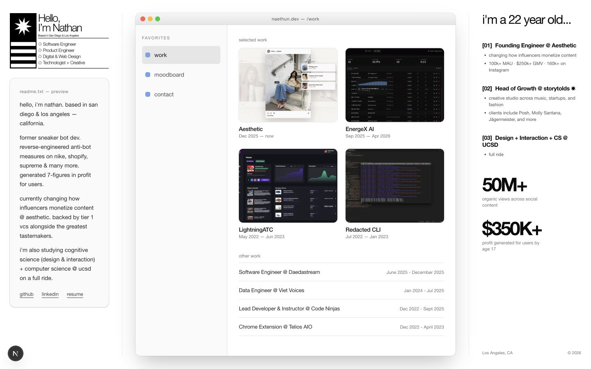
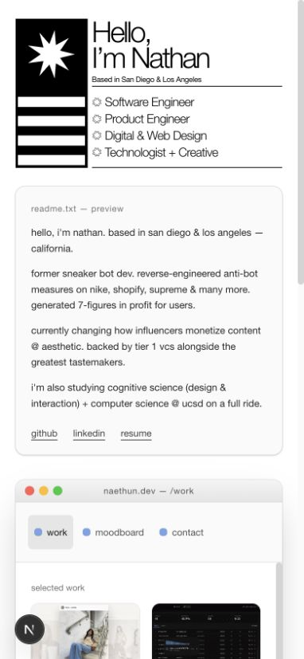
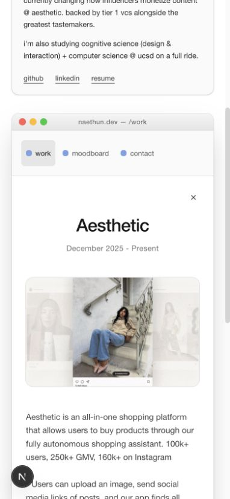
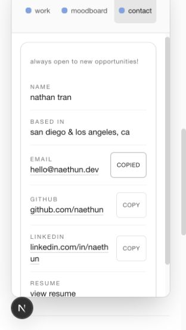
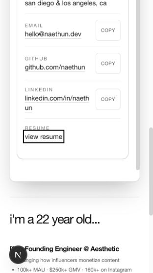
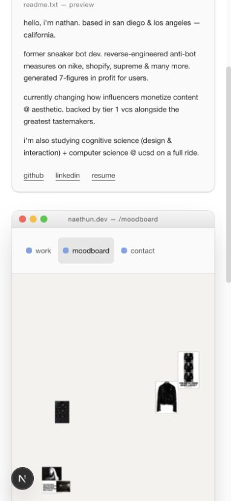
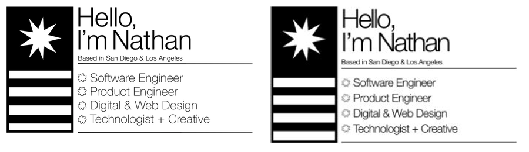

# Portfolio audit and cleanup

Audited the local portfolio on 2026-09-12. Scope: homepage identity, work browsing, case-study panels, contact, moodboard entry, and repository checks. The existing Finder layout, project order, biography, metrics, and experiment routes remain.

## Findings and repairs

| Priority | Finding | Result |
| --- | --- | --- |
| P1 | Opening a case study left keyboard focus on the covered card. | Focus enters a labelled nonmodal dialog; covered cards are inert. Escape closes it and restores the original card. Sidebar navigation remains available. |
| P1 | Contact details were truncated; the contact panel could overflow without scrolling. | Text wraps, panel scrolls, and the resume link is reachable at 320 × 568 with keyboard focus visible. |
| P2 | Zoom disabled by `maximumScale: 1`. | Removed the restriction. |
| P2 | Raster identity text becomes soft when scaled and provides no real heading. | Replaced with a native heading, location, role list, SVG marks, and CSS bars, using the existing Helvetica Neue stack. |
| P2 | Card captions switched to inline based on the page width, even in a narrow Finder column. | Container-based breakpoint keeps complete titles above dates until each card is at least 250px wide. |
| P2 | Gesture debug panel covered the mobile moodboard by default. | Debug is opt-in; existing D-key toggle retained. Camera remains opt-in. |
| P2 | Small contact and navigation controls. | Folder and copy buttons, plus case-study close, now have 44px minimum height. Copy controls have distinct accessible names and announce success or failure. |
| P2 | Lint traversed generated output in old nested worktrees. | Excluded `.worktrees` from lint and TypeScript; pinned Turbopack's project root. |
| P3 | Two unused Google font downloads, missing page description, typo cleanup. | Removed unused Inter/DM Sans setup, added description, corrected existing spelling without changing factual claims. Animated work GIFs bypass the image optimizer explicitly. |

## Flow evidence

1. **Identity and work — healthy at checked sizes.** Desktop 1440 × 900, mobile 390 × 844, narrow desktop 1280 × 720, and 320px width were inspected. The homepage has no horizontal document overflow. All four highlight images loaded. The selected native header retains the source composition; font metrics intentionally follow the website.

2. **Case study — repaired.** Open Aesthetic → focus on Close case study → Escape → focus returns to Open Aesthetic. The content area is keyboard-focusable and scrollable. Reduced-motion settings disable the slide transition in source; OS reduced-motion emulation and screen-reader testing were not performed.

3. **Contact — repaired.** At 320 × 568, details wrap and all copy buttons measure 44px tall. Copy email announced success. Tabbing to View resume scrolls it into view. External links were inspected but no emails/messages were sent. Clipboard rejection UI was inspected in source, not forced in the browser.

4. **Moodboard — entry healthy; camera flow unverified.** WebGL media rendered without the debug panel; the enable-gestures control remains available. No runtime errors appeared in the captured browser console. Camera permission, gesture recognition, fit-scan search and external services were not activated.

## Native header comparison

Source at left; native component at right. Comparison crops the source's unused white right margin and normalizes the content widths. Live text, a two-line heading, location rule, four role lines, star, black panel, and four white bars are retained. Helvetica Neue changes glyph metrics slightly; SVG outlines are a native reconstruction, not an exact vector extraction.

## Verification and limits

- ESLint: clean.
- Existing Node tests: 121 passed, 0 failed.
- TypeScript: passed.
- Production build: passed; all 14 static-generation entries completed.
- Build still reports outdated `baseline-browser-mapping` data. The retained JetBrains Mono font on the recording stage requires network access during a cold build.
- This is a local usability and code cleanup, not a production deployment, security certification, full accessibility certification, or complete camera/provider end-to-end audit.
- Some projects intentionally retain “case study coming soon.” Biographical ages and business metrics were preserved, not independently verified.
